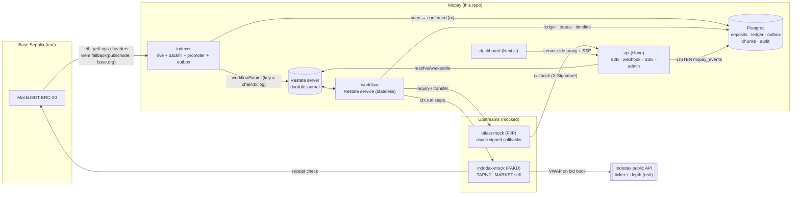
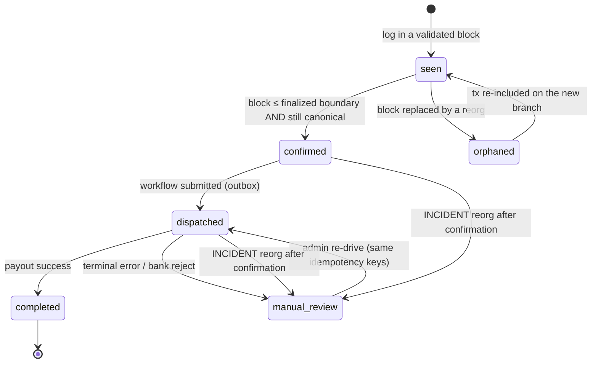

# Architecture

Mopay orchestrates; it never holds funds. Crypto custody and the USDT→IDR swap belong to a licensed
PAKD (exchange). Rupiah leaves through a PJP over BI-FAST. In this prototype both are mocks; the
**USDT/IDR price is real** (Indodax public order book) and the **chain is real** (Base Sepolia).

## Components



| Component | State                                 | Scales by                                                  | Failure behaviour                                                                  |
| --------- | ------------------------------------- | ---------------------------------------------------------- | ---------------------------------------------------------------------------------- |
| indexer   | Postgres (checkpoint, chunks, blocks) | 1 leader (advisory lock) for live; N replicas for backfill | crash → restart resumes from checkpoint; leases expire → chunks re-claimed         |
| workflow  | none (Restate journal)                | N replicas behind Restate                                  | crash mid-step → Restate re-invokes; journaled steps are replayed, not re-executed |
| api       | none                                  | N replicas                                                 | webhook retried by BI-FAST until 2xx                                               |
| restate   | own durable log                       | cluster (production)                                       | —                                                                                  |
| postgres  | system of record                      | HA pair (production)                                       | —                                                                                  |

## Offramp sequence

```mermaid
sequenceDiagram
  autonumber
  participant C as Client wallet
  participant CH as Base Sepolia
  participant IX as Indexer
  participant DB as Postgres
  participant R as Restate
  participant W as offramp workflow
  participant M as Indodax (PAKD)
  participant B as BI-FAST (PJP)
  participant A as API webhook

  C->>CH: transfer USDT → deposit address
  IX->>CH: headers (batch) + getLogs(range); verify log.blockHash == header.hash
  IX->>DB: tx{ blocks, deposit(status=seen), checkpoint }
  Note over IX: ~0.8 s after the receipt
  IX->>CH: block still canonical at height? (promoter)
  IX->>DB: seen → confirmed (outbox) once ≤ safe boundary
  IX->>R: workflowSubmit(key = 84532:tx:logIndex)
  IX->>DB: confirmed → dispatched
  R->>W: run(depositId)
  W->>DB: load-deposit · record-received (journal "received")
  loop until credited (durable sleep)
    W->>M: GET /api/v2/capital/deposit/hisrec (txId + amount)
  end
  W->>W: price check: VWAP of live Indodax bids + slippage floor
  W->>M: POST /api/v2/order MARKET SELL  newClientOrderId = hash(wf)
  W->>M: GET /api/v2/myTrades?clientOrderId (fills, commission)
  W->>DB: record-swap (journal "swap", fee 0.35% rounded up)
  W->>B: account-inquiry (name must match)
  W->>DB: payouts row (UNIQUE) + awakeable id
  W->>B: POST /v1/transfers  Idempotency-Key = wf:payout
  B-->>A: callback {status} + X-Signature (maybe duplicated / late / dropped)
  A->>A: verify HMAC · dedup transferId:status
  A->>R: resolveAwakeable(id)
  alt callback timeout
    W->>B: GET /v1/transfers/:id (reconcile), keep waiting
  end
  W->>DB: finalize: payout success · journal "payout" · deposit completed
```

Every `W->…` arrow is a `ctx.run` step: its result is journaled in Restate, and a retryable error is
retried with exponential backoff **forever**, while a terminal error moves the deposit to `manual_review`.

## Deposit state machine

Enforced by a Postgres trigger (`deposits_transition_guard`), not only by application code.



`orphaned → confirmed/dispatched` is impossible, so a deposit hit by a reorg can never be paid.

## Ledger

| Journal (`<depositId>:…`) | Debit                                                      | Credit                                                                          |
| ------------------------- | ---------------------------------------------------------- | ------------------------------------------------------------------------------- |
| `received`                | `exchange_usdt` (USDT)                                     | `client_usdt_liability` (USDT)                                                  |
| `swap`                    | `client_usdt_liability` (USDT), `exchange_idr` (IDR gross) | `exchange_usdt` (USDT), `client_idr_payable` (IDR net), `fee_revenue` (IDR fee) |
| `payout`                  | `client_idr_payable` (IDR net)                             | `bank_out` (IDR net)                                                            |

A deferred constraint trigger rejects any unbalanced journal at COMMIT; entries are append-only;
journal ids are deterministic, so a retried step cannot post twice.

## Where each requirement lives

| Requirement                                 | Mechanism                                                                                                         | Proof                                                                   |
| ------------------------------------------- | ----------------------------------------------------------------------------------------------------------------- | ----------------------------------------------------------------------- |
| Every step durable + auto-retry             | Restate `ctx.run`, unlimited retries for retryable errors, `TerminalError` for the rest                           | `apps/workflow/test` — 100 deposits under FAIL_RATE 0.3 + kill mid-swap |
| Indexer fast + durable, catch-up while live | batched live path; jump to finalized boundary; SKIP LOCKED chunk workers with leases; sweeps                      | `apps/indexer/test`, `make demo-catchup(-sim)`                          |
| No double payout                            | Restate key per deposit; idempotency keys `wf:swap`, `wf:payout`; `payouts.deposit_id` UNIQUE; ledger journal PKs | invariants (`make invariants`)                                          |
| No processing of reorged deposits           | parent-hash reorg detection + rollback in one tx; RPC re-check at promotion; DB state guard                       | `make demo-reorg`, indexer reorg tests                                  |
| Toward 99.999 %                             | stateless services, leader election, multi-RPC fallback, crash recovery everywhere                                | [production.md](production.md)                                          |
